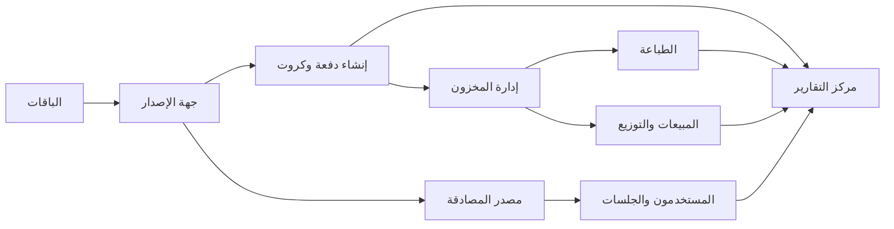

# Nexora | Network Operations & Card Management Demo

**نسخة عرض WPF لنظام إدارة أعمال شبكات الإنترنت وإصدار الكروت**
**التقنية:** C# · WPF · .NET 10 · Windows x64

نسخة Preview لمراجعة تجربة الاستخدام وتقسيم الوحدات. ليست إصدار إنتاج، ويُوضح `docs/DEMO-SCOPE.md` حدود البيانات والتكامل في هذا الإصدار.

## لماذا Nexora؟

Nexora تُنظّم سير العمل حول احتياج صاحب الشبكة، بدل تكرار الوظائف نفسها داخل كل مصدر مصادقة. تظهر الحسابات في نقطة إدارة موحدة، بينما تبقى إعدادات HotSpot وUser Manager وتكويناتهما الفنية منفصلة. الإصدار والطباعة والبيع والتقارير مراحل مستقلة ولا تُعامل كحالة واحدة.

## مسار الاستخدام



## وحدات الديمو

| الوحدة | ما يمكن مراجعته |
|---|---|
| الرئيسية | ملخص العمل ومداخل التنقل |
| مستخدمو الشبكة | واجهة موحّدة للحسابات وتصفية حسب النشاط وجهة الإصدار |
| الكروت والدفعات | اختيار النظام المستهدف، إصدار محلي تجريبي، وإدارة الكروت والدفعات |
| الباقات | تعريف تجاري مع تكوين منفصل لجهتي HotSpot وUser Manager |
| المبيعات ونقاط البيع | ملخصات ومعاملات وسجلات تجريبية |
| الطباعة والتصميم | معاينة الكرت وإرسال مهمة إلى نظام طباعة Windows |
| الشبكات ومصادر المصادقة | صفحات منفصلة لمصادر المصادقة وإعدادات العرض |
| مركز التقارير | تقارير متخصصة حسب نوع البيانات، مع فلاتر وفرز وتخصيص أعمدة وتصدير CSV حيث تدعمه الشاشة |

الخريطة التفصيلية في [docs/PRODUCT-MODULES.md](docs/PRODUCT-MODULES.md). حدود الإصدار موثقة في [docs/DEMO-SCOPE.md](docs/DEMO-SCOPE.md).

## تشغيله من المصدر

المتطلبات: Windows 10/11 و.NET 10 SDK.

1. نزّل المستودع أو استنسخه.
2. شغّل `Run-Nexora-Demo.cmd`، أو نفّذ الأوامر التالية من جذر المستودع:

```powershell
dotnet restore .\Nexora.Demo.slnx
dotnet run --project .\Nexora.Demo.Desktop\Nexora.Demo.Desktop.csproj
```

## بيانات الدخول التجريبية

هذه بيانات محلية مضمّنة في نسخة العرض، وليست بيانات شبكة حقيقية:

| الحساب | الهاتف | كلمة المرور |
|---|---|---|
| الشبكة التجريبية | `777000001` | `Nexora@123`، مع كود الشبكة `23400` |
| حساب التجربة | `777000202` | `Trial@123` |

يمكن إنشاء حساب تجربة جديد من الشاشة. يُطلب موقع الشبكة لهذا الحساب بعد تسجيل الدخول وفق تدفق الواجهة.

## GitHub CI ونسخة التشغيل

- عند Push أو Pull Request إلى `main`، يشغّل `Windows Build & Demo Package` على `windows-latest` باستخدام .NET 10.
- يتحقق سير العمل من استعادة الحزم وبناء Release، ثم ينشر ZIP ذاتي الاحتواء لويندوز x64 كـ Artifact.
- لإنشاء Release تجريبي قابل للتنزيل بعد مراجعة البناء، أنشئ tag بصيغة `demo-v0.1.0` وادفعه. ينشئ `Publish Demo Release` إصدارًا تمهيديًا ويُرفق `Nexora-Demo-Preview-win-x64.zip`.
- دليل مراجعة الفروع وPull Requests في [docs/REVIEW-GUIDE.md](docs/REVIEW-GUIDE.md).

**حالة البناء:** لم تُسجل نتيجة CI للمستودع بعد؛ تُعد النتيجة ناجحة فقط بعد تنفيذ سير العمل على GitHub وظهور العلامة الخضراء.

## لماذا فصل الوحدات؟

- حساب شبكة الإنترنت يختلف عن حساب موظف Nexora.
- حالة «نشط الآن» تعني وجود جلسة وفق بيانات المصدر، وليست نوعًا مستقلاً من الحسابات.
- إنشاء كرت وتجهيزه للطباعة وبيعه ومزامنته عمليات منفصلة.
- كتالوج الباقات التجاري مشترك، لكن تكوين HotSpot لا يُفترض أنه قابل للاستخدام دون تعديل في User Manager.
- مركز التقارير يقرأ مصادر الوحدات ولا يستبدل منطقها.

## ملاحظات المساهمة والمراجعة

- أنشئ فرعًا لكل تغيير، ولا تدفع تغييرات مباشرة إلى `main`.
- افتح Pull Request مع شرح مختصر وخطوات الاختبار ولقطات الشاشة للتغييرات المرئية.
- لا تُضمّن أسرار الراوتر أو بيانات عملاء حقيقية أو ملفات `bin/obj` أو بيانات محلية في commits.
- استخدم قوالب Issues وPull Requests الموجودة في `.github/`.
